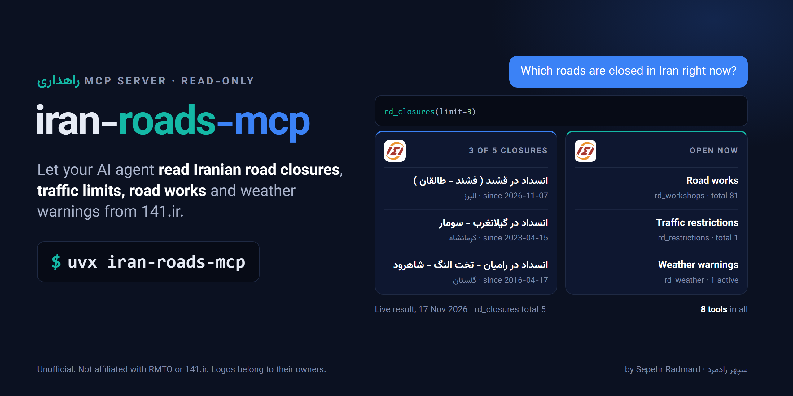

<!-- mcp-name: io.github.sepehr071/iran-roads-mcp -->

<div align="center">



# iran-roads-mcp: 141.ir (راهداری) road status MCP server for AI agents, Iran road closures and traffic

**iran-roads-mcp is an unofficial, read-only MCP server that lets an AI agent read Iran's road status from 141.ir (۱۴۱, the road information service of the Road Maintenance and Transportation Organization, RMTO, راهداری و حمل‌ونقل جاده‌ای).**<br>
Its 8 tools read the official road bulletin, closed roads, police traffic restrictions, road works, road weather warnings, the 22 main intercity axes and province traffic map images.<br>
No API key or account is needed; it works in Claude, Cursor, Copilot and any other MCP client.

[](https://pypi.org/project/iran-roads-mcp/)
[](https://pypi.org/project/iran-roads-mcp/)
[](https://github.com/sepehr071/iran-roads-mcp/actions/workflows/ci.yml)
[](https://github.com/sepehr071/iran-roads-mcp/blob/main/LICENSE)

[For AI agents](#for-ai-agents) · [Quick start](#quick-start) · [Tools](#tools) · [Limits](#limits) · [فارسی](#فارسی)

</div>

---

## For AI agents

- **What:** unofficial MCP server (model context protocol) for 141.ir and its API api.141.ir: the road bulletin, closures, traffic restrictions, road works, weather warnings, main axes and province traffic maps.
- **Install:** `uvx iran-roads-mcp` or `claude mcp add iran-roads -- uvx iran-roads-mcp`. Transport: stdio. Needs [uv](https://docs.astral.sh/uv/getting-started/installation/) (Python 3.10+).
- **Auth:** none. Optional `IRAN_ROADS_MCP_PROXY` (HTTP proxy URL, or a comma-separated list); system proxy settings are ignored.
- **Access:** read-only, no confirmation needed. It answers from any network, an Iranian IP is not required.
- **Tools:** 8, all prefixed `rd_`. List tools take `province` (id or Persian name, from `rd_provinces`), `limit` and `page`.
- **Use when:** the user asks whether a road in Iran is closed, what traffic limits or road works are active, or what the road weather warning says.
- **Do not use when:** the user needs live traffic counters or road cameras, which are not offered.
- **Output:** compact JSON with Persian official announcement texts, ASCII digits and coordinates.

## Quick start

You need [uv](https://docs.astral.sh/uv/getting-started/installation/). No API key or account.

Claude Code:

```bash
claude mcp add iran-roads -- uvx iran-roads-mcp
```

Claude Desktop, Cursor, VS Code and other clients:

```json
{
  "mcpServers": {
    "iran-roads": { "command": "uvx", "args": ["iran-roads-mcp"] }
  }
}
```

Example prompts:

- "Which roads are closed in Iran right now?"
- "Are there road works on the Tehran-Qom highway?"
- "What is the latest road weather bulletin for the northern axes?"
- <span dir="rtl">آیا جاده‌ی فشند - طالقان بسته است؟</span>
- <span dir="rtl">محدودیت‌های ترافیکی فعلی در استان کردستان چیست؟</span>

Real answer (17 Nov 2026): `rd_closures` returned 5 closures in total, among them "انسداد در قشند ( فشند - طالقان )" in Alborz (since 2026-11-07). `rd_workshops` returned 81 road works and `rd_restrictions` 1 police restriction.

## Tools

| Tool | What it does |
|---|---|
| `rd_provinces` | List the 31 provinces with the ids the other tools accept. |
| `rd_bulletin` | Latest official road weather and traffic status bulletin of the Road Maintenance Organization. |
| `rd_closures` | List current road closures (blockades) with cause, direction, alternative route text and coordinates. |
| `rd_restrictions` | List traffic restrictions announced by the traffic police (vehicle types or hours, road still open). |
| `rd_workshops` | List road works with work type, whether traffic can pass, period and alternative route. |
| `rd_weather` | Current road weather warnings: hazard, affected provinces by day and validity dates. |
| `rd_main_routes` | List the 22 main intercity axes the 141 app tracks, with endpoints. |
| `rd_traffic_map` | Get the URL of a province's traffic status map image. |

## Limits

- Entries stay listed until the operator removes them: some closures date from years ago. Check the `since` and `until` fields.
- Not offered: traffic counters (تردد شمار, they need a 141 login) and road cameras (the public camera endpoint returns nothing).
- The province filter of the bulletin was not verified for every province (it returned nothing for two provinces tested).
- The tools read the same API the 141.ir page calls. Counts were matched against the page's banner and slideshow, not field by field against the page.
- Texts are Persian official announcements. The traffic map tool returns an image URL, not the image.

## How it works

141.ir has no documented public API. The server calls the JSON routes of api.141.ir that the site itself uses, always sending a JSON `Accept` header (Laravel answers errors with a redirect otherwise). The routes were mapped in a real browser and the 141.ir page counts (81 road works, 1 police restriction, 5 closures, 1 weather warning) were checked in Chrome against the tool totals. Requests present Chrome's TLS fingerprint, run two at a time with a short cache.

## فارسی

<div dir="rtl">

iran-roads-mcp یک سرور MCP غیررسمی و فقط‌خواندنی است که به دستیار هوش مصنوعی اجازه می‌دهد وضعیت جاده‌های ایران را از سامانه‌ی ۱۴۱ (راهداری و حمل‌ونقل جاده‌ای) بخواند: بولتن رسمی وضعیت جاده‌ها، جاده‌های مسدود، محدودیت‌های ترافیکی پلیس، کارگاه‌های جاده‌ای، هشدارهای هواشناسی جاده‌ای، محورهای اصلی و نقشه‌ی ترافیک استان‌ها. کلید API یا حساب کاربری لازم نیست. نصب در Claude Code:

</div>

```bash
claude mcp add iran-roads -- uvx iran-roads-mcp
```

## Development

```bash
uv sync
uv run ruff check . && uv run ruff format --check .
uv run python -m pytest -q          # offline tests on recorded fixtures
uv run python -m pytest -m live -q  # real api.141.ir
```

Releases: bump the version in `pyproject.toml` and `server.json`, run `uv lock`, then push a `v*` tag; GitHub Actions publishes to PyPI and the MCP Registry.

## Disclaimer

Unofficial and not affiliated with or endorsed by RMTO or 141.ir. It is read-only and uses the public API of 141.ir, which can change without notice. For safety decisions on the road, follow official announcements.

## Author

Built and maintained by **Sepehr Radmard** (سپهر رادمرد). [LinkedIn](https://www.linkedin.com/in/sepehr-radmard) · [GitHub](https://github.com/sepehr071) · more servers in [iran-mcp](https://github.com/sepehr071/iran-mcp).

## License

[MIT](https://github.com/sepehr071/iran-roads-mcp/blob/main/LICENSE)
